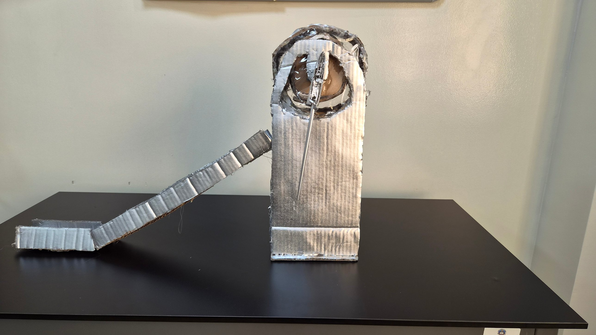
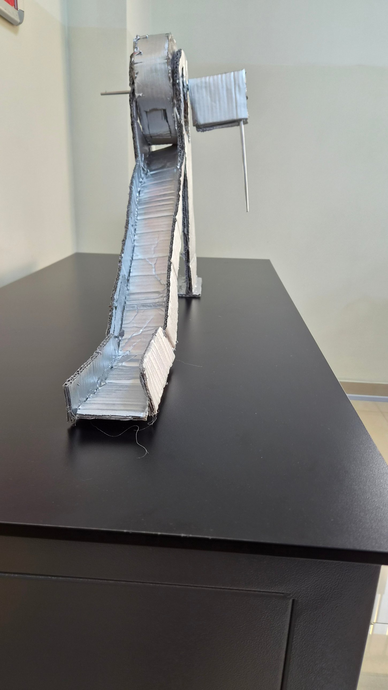
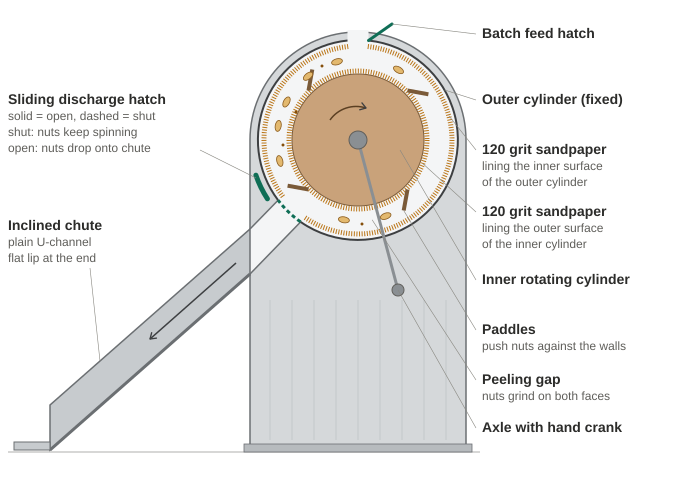
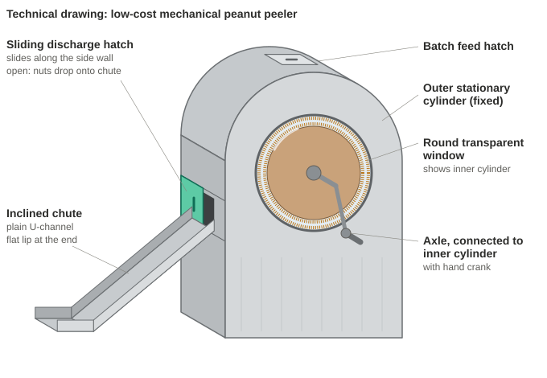

<div align="center">

# 🥜 Low-Cost Mechanical Cardboard Peanut Skinner

**An open-source, hand-cranked peanut skinner (peeler) with an inclined discharge chute, built from everyday materials.**

[](https://ohwr.org/cernohl)
[](https://www.oshwa.org/)

Copyright © 2026 Parham Shirvan

</div>

---

## About

This project is an ultra-low-cost, hand-cranked machine that removes the skins from peanuts. A rotating inner cylinder and a stationary outer cylinder are both lined with 120-grit sandpaper, and the peanuts are tumbled between them until their skins rub off. It is designed to support post-harvest value addition, the agricultural circular economy, and appropriate technology for smallholder farmers.

## Table of Contents

1. [System Overview & Diagrams](#system-overview--diagrams)
2. [Sustainable Development Goals](#sustainable-development-goals)
3. [Mechanical Specifications](#mechanical-specifications)
4. [Bill of Materials](#bill-of-materials)
5. [Build & Assembly Instructions](#build--assembly-instructions)
6. [Operating Instructions](#operating-instructions)
7. [Waste Utilization & Circular Economy](#waste-utilization--circular-economy)
8. [License](#license)

---

## System Overview & Diagrams


*Figure 1: Full assembly of the hand-cranked cardboard peanut skinner, shown with its inclined discharge chute.*


*Figure 2: Plain inclined U-channel chute with a flat lip at the end, seen from the chute end.*


*Figure 3: Cross-section schematic showing the 120-grit sandpaper linings on the inner and outer cylinders, the cardboard paddles, the peeling gap, and the sliding discharge hatch (solid = open, dashed = shut).*


*Figure 4: Exterior view showing the batch feed hatch, round transparent window, axle with hand crank, sliding discharge hatch, and inclined chute.*

---

## Sustainable Development Goals

| SDG | How this project contributes |
| :--- | :--- |
| **SDG 9: Industry, Innovation, and Infrastructure** | Promotes inclusive, low-cost agricultural mechanization through open technology transfer. |
| **SDG 12: Responsible Consumption and Production** | Supports a zero-waste agricultural cycle by turning removed peanut skins into organic soil amendments. |
| **SDG 13: Climate Action** | Encourages climate-conscious, low-energy post-harvest processing. |

---

## Mechanical Specifications

| Parameter | Specification |
| :--- | :--- |
| **Mechanism** | Concentric drum skinning: a rotating inner drum inside a stationary outer drum (concave) |
| **Abrasion surface** | 120-grit sandpaper on both the inner drum and the stationary concave |
| **Paddles** | 2–4 cardboard paddles mounted horizontally across the inner drum to tumble the peanuts and push them against the sandpaper |
| **Clearance gap** | **10–11 mm**, set with internal cardboard shims |
| **Drive** | Hand crank on the axle |
| **Discharge** | Sliding hatch at the outlet: shut, peanuts keep spinning; open, peanuts drop onto the chute |

---

## Bill of Materials

| Item | Quantity | Purpose |
| :--- | :---: | :--- |
| Heavy cardboard | 2–3 sheets | Main frame, drum walls, side stands, paddles, and chute |
| 120-grit sandpaper | 2 sheets | Abrasion surface for removing peanut skins |
| Clear plastic sheet or bottle | 1 piece | Transparent viewing window on the side panel |
| Hot glue and packing tape | As needed | Frame assembly and reinforcing the chute |

---

## Build & Assembly Instructions

### Step 1: Framework and Axle

1. Cut two identical vertical cardboard side stands.
2. Cut a circular inner drum and mount it securely on the central turning axle, with a hand crank on the outside end.
3. Cut a viewing window in one side stand and seal it with clear plastic so you can see the skinning gap.


*Figure 5: Side window detail, showing peanuts moving through the drum gap.*

### Step 2: Skinning Chamber and Gap Setup

1. Wrap and glue 120-grit sandpaper around the rotating inner drum.
2. Glue 2–4 cardboard paddles horizontally across the inner drum, spaced evenly around it, so they tumble the peanuts and push them against the outer wall.
3. Form the curved, stationary outer drum wall and line its inner surface with 120-grit sandpaper.
4. Insert cardboard shims behind the outer wall to set a **10–11 mm clearance gap** between the paddles and the outer wall.


*Figure 6: Close-up of the cardboard paddles and the cardboard shims that set the 10–11 mm gap.*

### Step 3: Discharge Hatch and Chute

1. Cut a discharge outlet in the lower part of the outer wall.
2. Fit a sliding hatch over the outlet, running on cardboard rails, so it can be opened and shut. Line its inner face with 120-grit sandpaper so it sits flush with the outer wall when shut.
3. Mount an inclined cardboard chute directly beneath the outlet, shaped as a plain U-channel with a flat lip at the end.
4. Place a collection bin at the end of the chute.

---

## Operating Instructions

1. Make sure the sliding discharge hatch is shut.
2. Open the batch feed hatch, load **3–5 peanuts at a time**, and close it again.
3. Turn the hand crank continuously at **1–2 rotations per second**.
4. Watch through the window until the skins have rubbed off the peanuts.
5. Open the sliding discharge hatch so the peanuts drop onto the chute and into the collection bin.
6. Shut the hatch and repeat with the next batch.

---

## Waste Utilization & Circular Economy

The peanut skins removed during peeling are a useful agricultural input, not refuse:

1. **Mulching and soil conditioning:** Skins can be worked into soil to add organic matter and help retain water.
2. **Compost:** Skins can be added to a compost pile as organic material for smallholder gardens.
3. **Zero-waste value addition:** Reusing the skins alongside peanut processing closes the loop, turning agricultural waste into soil health.

---

## License

The documentation, schematics, photos, and design files in this project are licensed under the **[CERN Open Hardware Licence Version 2 – Strongly Reciprocal (CERN-OHL-S v2)](https://ohwr.org/cernohl)**.

### Summary of Terms

*This is a plain-language summary only. The full license text is the binding document.*

| Requirement | What it means |
| :--- | :--- |
| **Reciprocal distribution** | Modified or derivative versions of this design must be released under the same CERN-OHL-S v2 license. |
| **Attribution** | Keep all original copyright and license notices and credit the original author. |
| **Source availability** | If you distribute products or modifications made from these files, you must also provide the complete source design files and diagrams. |

### License Notice

```
Copyright (c) 2026 Parham Shirvan

This source describes Open Hardware and is licensed under the CERN-OHL-S v2.

You may redistribute and modify this source and make products using it under
the terms of the CERN-OHL-S v2 (https://ohwr.org/cern_ohl_s_v2.txt).

This source is distributed WITHOUT ANY EXPRESS OR IMPLIED WARRANTY, INCLUDING
OF MERCHANTABILITY, SATISFACTORY QUALITY AND FITNESS FOR A PARTICULAR PURPOSE.
Please see the CERN-OHL-S v2 for applicable conditions.

Source location:https://github.com/parham1572/LOW-COST-MECHANICAL-NUT-PEELER

- **Full license:** <https://ohwr.org/cernohl>
- **License file:** see `LICENSE.txt` in this repository.
